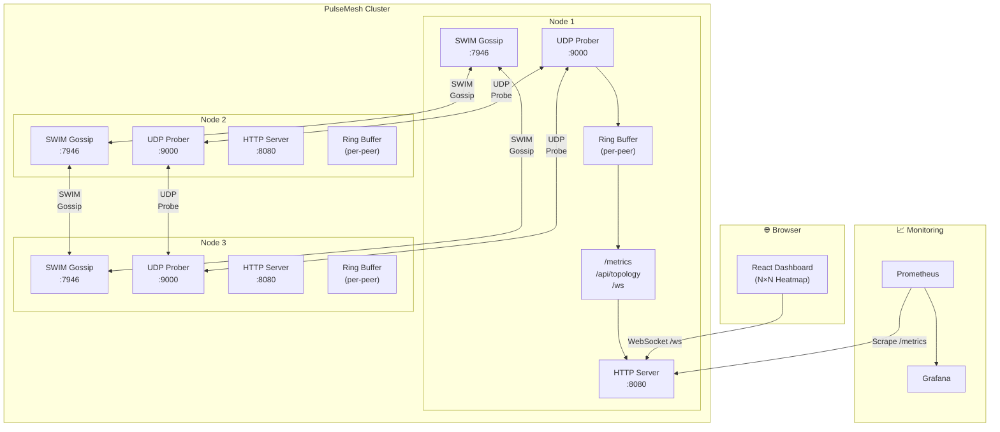

<p align="center">
  
  
  
  
</p>

# PulseMesh

### Distributed Network Latency & Path-Health Matrix

> **Real-time N×N latency heatmap for every link in your cluster.** Deploy PulseMesh across your infrastructure and instantly see which paths are healthy, degraded, or failing — with zero config and zero dependencies.

---

## ✨ Overview

PulseMesh is a lightweight, distributed network telemetry daemon that forms a self-organizing mesh using the [SWIM gossip protocol](https://www.cs.cornell.edu/projects/Quicksilver/public_pdfs/SWIM.pdf). Every node continuously probes every other node via UDP, records round-trip latencies in a lock-free ring buffer, and computes streaming percentiles (p50 / p95 / p99). The results are broadcast over WebSocket to an embedded React dashboard that renders a beautiful, real-time **N×N latency heatmap**.

### Key Features

- 🔍 **Zero-config peer discovery** — SWIM gossip via [hashicorp/memberlist](https://github.com/hashicorp/memberlist); nodes find each other automatically
- 📡 **UDP round-trip probing** — Sub-millisecond resolution latency measurement between all node pairs
- 📊 **Live N×N heatmap** — Color-coded latency matrix in your browser, updated in real-time via WebSocket
- 📈 **Prometheus metrics** — Native `/metrics` endpoint for alerting and long-term storage
- 🔄 **Ring buffer percentiles** — Streaming p50 / p95 / p99 without heap allocations
- 🐳 **Single-binary deployment** — Embeds the React UI; just run the binary or Docker image
- 🔥 **Chaos engineering ready** — Built-in `tc`/`netem` chaos injection script

---

## 🏗️ Architecture



**Data Flow:**

1. **Gossip** — Nodes exchange membership via SWIM protocol on port `7946`
2. **Probe** — Each node sends UDP pings to all known peers on port `9000`
3. **Record** — Round-trip times are pushed into per-peer ring buffers
4. **Compute** — Percentiles (p50/p95/p99) are calculated from the buffer
5. **Broadcast** — Metrics are exposed via Prometheus and streamed over WebSocket
6. **Visualize** — The React dashboard renders the live N×N heatmap

---

## 🚀 Quickstart

### Docker Compose (Recommended)

Spin up a 5-node cluster in seconds:

```bash
# Clone the repository
git clone https://github.com/youruser/pulsemesh.git
cd pulsemesh

# Start the 5-node cluster
make docker-up

# Open the dashboard
open http://localhost:8080
```

That's it. Five nodes will discover each other, start probing, and you'll see the heatmap populate within seconds.

### Local Development

```bash
# Install dependencies and build
make build

# Run a single node in dev mode
make dev

# Run tests
make test
```

### Multi-Node Local Testing

Open multiple terminals:

```bash
# Terminal 1 — Seed node
./bin/pulsemesh --node-name=node-1 --http-port=8080 --gossip-port=7946 --probe-port=9000

# Terminal 2 — Join the seed
./bin/pulsemesh --node-name=node-2 --http-port=8081 --gossip-port=7947 --probe-port=9001 --join=localhost:7946

# Terminal 3 — Join the seed
./bin/pulsemesh --node-name=node-3 --http-port=8082 --gossip-port=7948 --probe-port=9002 --join=localhost:7946
```

---

## ⚙️ CLI Reference

| Flag | Default | Description |
|------|---------|-------------|
| `--node-name` | hostname | Unique name for this node in the mesh |
| `--bind-addr` | `0.0.0.0` | Address to bind all listeners on |
| `--gossip-port` | `7946` | Port for SWIM gossip protocol (TCP + UDP) |
| `--probe-port` | `9000` | Port for UDP latency probes |
| `--http-port` | `8080` | Port for the HTTP dashboard and API |
| `--join` | *(none)* | Address of an existing node to join (`host:port`) |
| `--probe-interval` | `1s` | How often to probe each peer |
| `--probe-timeout` | `3s` | Timeout for each probe round-trip |
| `--buffer-size` | `64` | Number of samples in the per-peer ring buffer |

---

## 📡 API Reference

### `GET /metrics`

Prometheus-format metrics endpoint.

```
pulsemesh_probe_rtt_ms{source="node-1",target="node-2",quantile="0.5"} 1.23
pulsemesh_probe_rtt_ms{source="node-1",target="node-2",quantile="0.95"} 4.56
pulsemesh_probe_rtt_ms{source="node-1",target="node-2",quantile="0.99"} 8.91
pulsemesh_probe_loss_ratio{source="node-1",target="node-2"} 0.02
pulsemesh_cluster_size 5
```

### `GET /api/topology`

Returns the full mesh topology with latency data as JSON.

```json
{
  "self": "node-1",
  "peers": ["node-2", "node-3", "node-4", "node-5"],
  "matrix": {
    "node-1->node-2": { "p50": 1.23, "p95": 4.56, "p99": 8.91, "loss": 0.02 },
    "node-1->node-3": { "p50": 2.10, "p95": 5.30, "p99": 9.80, "loss": 0.01 }
  },
  "timestamp": "2025-01-15T10:30:00Z"
}
```

### `GET /ws`

WebSocket endpoint streaming live latency updates.

```json
{
  "type": "probe_result",
  "source": "node-1",
  "target": "node-2",
  "rtt_ms": 1.45,
  "timestamp": "2025-01-15T10:30:01.234Z"
}
```

---

## 📈 Prometheus Integration

### Scrape Configuration

Add to your `prometheus.yml`:

```yaml
scrape_configs:
  - job_name: "pulsemesh"
    scrape_interval: 5s
    static_configs:
      - targets:
          - "localhost:8080"
          - "localhost:8081"
          - "localhost:8082"
          - "localhost:8083"
          - "localhost:8084"
        labels:
          cluster: "pulsemesh-local"
```

### Grafana Dashboard Queries

**P95 latency between all node pairs:**

```promql
pulsemesh_probe_rtt_ms{quantile="0.95"}
```

**Packet loss heatmap:**

```promql
pulsemesh_probe_loss_ratio * 100
```

**Average cluster-wide P50 latency:**

```promql
avg(pulsemesh_probe_rtt_ms{quantile="0.5"})
```

**Nodes with loss > 5% (alerting):**

```promql
pulsemesh_probe_loss_ratio > 0.05
```

---

## 🔥 Chaos Engineering

PulseMesh ships with a built-in chaos injection script that uses Linux `tc`/`netem` to simulate real-world network degradation.

### Inject Chaos

```bash
# Default: 85ms delay, 15ms jitter, 8% packet loss on node-3
make chaos-inject

# Custom parameters
bash deploy/chaos.sh inject pulsemesh-node-3 100ms 25ms 12%
```

### Observe the Impact

Once chaos is injected, open the dashboard at `http://localhost:8080` and watch:

- 🟡 **node-3's row/column** in the heatmap shifts from green to yellow/red
- 📈 **p95 and p99** latencies for node-3 pairs spike visibly
- 📉 **Packet loss** counters increment for all paths through node-3

### Remove Chaos

```bash
make chaos-remove
```

### Check Status

```bash
bash deploy/chaos.sh status pulsemesh-node-3
```

---

## 🧬 Architecture Deep-Dive

### SWIM Gossip Protocol

PulseMesh uses [hashicorp/memberlist](https://github.com/hashicorp/memberlist), an implementation of the [SWIM](https://www.cs.cornell.edu/projects/Quicksilver/public_pdfs/SWIM.pdf) protocol, for decentralized peer discovery:

- **No single point of failure** — every node maintains a full membership list
- **Failure detection** — piggybacks suspicion on protocol messages
- **Convergence** — membership changes propagate in O(log N) gossip rounds
- **Bandwidth-efficient** — uses UDP with bounded per-node overhead

When a node starts, it joins an existing member (`--join`). The gossip protocol then disseminates its existence to all other nodes. When a node departs or fails, SWIM detects and propagates the removal.

### Probe Scheduling

Each node runs a probe scheduler that cycles through all known peers:

```
┌─────────────────────────────────────────┐
│  Scheduler (ticker = probe-interval)    │
│                                         │
│  for each peer in membership list:      │
│    1. Send UDP ping with timestamp      │
│    2. Wait for pong (up to timeout)     │
│    3. Compute RTT = pong.ts - ping.ts   │
│    4. Push RTT into ring buffer[peer]   │
│    5. Recompute percentiles             │
│    6. Broadcast via WebSocket hub       │
└─────────────────────────────────────────┘
```

Probes are staggered to avoid burst traffic — each peer is probed at an offset within the interval window.

### Ring Buffer & Percentile Calculation

Each peer connection maintains a fixed-size ring buffer (default: 64 samples):

```
Ring Buffer [peer "node-2"]:
┌────┬────┬────┬────┬────┬────┬────┬────┐
│1.2 │1.4 │1.1 │1.3 │5.2 │1.2 │1.5 │1.3 │  ← 64 slots
└────┴────┴────┴────┴────┴────┴────┴────┘
                                     ↑ write cursor

Percentile computation:
  1. Copy buffer to temp slice
  2. Sort (insertion sort — fast for small N)
  3. p50 = sorted[len/2]
  4. p95 = sorted[len*95/100]
  5. p99 = sorted[len*99/100]
```

This approach is allocation-free in steady state and provides accurate percentiles over a sliding window.

### WebSocket Broadcast Hub

The HTTP server runs a central broadcast hub:

```
┌──────────────────────────────────┐
│         WebSocket Hub            │
│                                  │
│  clients: map[*conn]bool         │
│  broadcast: chan message          │
│                                  │
│  On new probe result:            │
│    hub.broadcast <- result       │
│                                  │
│  Hub goroutine:                  │
│    for msg := range broadcast:   │
│      for client := range clients:│
│        client.send(msg)          │
└──────────────────────────────────┘
```

Clients connect via `GET /ws` and receive a stream of probe results. The React dashboard uses these to update the heatmap cells in real-time.

---

## 🤝 Contributing

Contributions are welcome! Here's how to get started:

1. **Fork** the repository
2. **Create** a feature branch: `git checkout -b feat/my-feature`
3. **Write tests** for your changes: `make test`
4. **Ensure** the linter passes: `golangci-lint run`
5. **Commit** with a clear message: `git commit -m "feat: add XYZ"`
6. **Push** and open a **Pull Request**

### Development Setup

```bash
# Prerequisites
# - Go 1.22+
# - Node.js 20+
# - Docker & Docker Compose

# Clone and build
git clone https://github.com/youruser/pulsemesh.git
cd pulsemesh
make build

# Run tests
make test

# Start local dev node
make dev
```

### Code Structure

```
pulsemesh/
├── cmd/pulsemesh/      # CLI entrypoint
├── internal/
│   ├── gossip/         # SWIM memberlist integration
│   ├── probe/          # UDP probe scheduler & ring buffer
│   ├── metrics/        # Prometheus metrics collectors
│   └── hub/            # WebSocket broadcast hub
├── web/                # React dashboard (Vite + TypeScript)
├── deploy/
│   ├── Dockerfile      # Multi-stage build
│   ├── docker-compose.yml
│   └── chaos.sh        # Chaos injection script
├── Makefile
└── README.md
```

---

## 📄 License

This project is licensed under the **MIT License** — see the [LICENSE](LICENSE) file for details.

---

<p align="center">
  <b>PulseMesh</b> — See your network. Know your latency. Own your mesh.<br/>
  Built with ❤️ in Go + React
</p>
